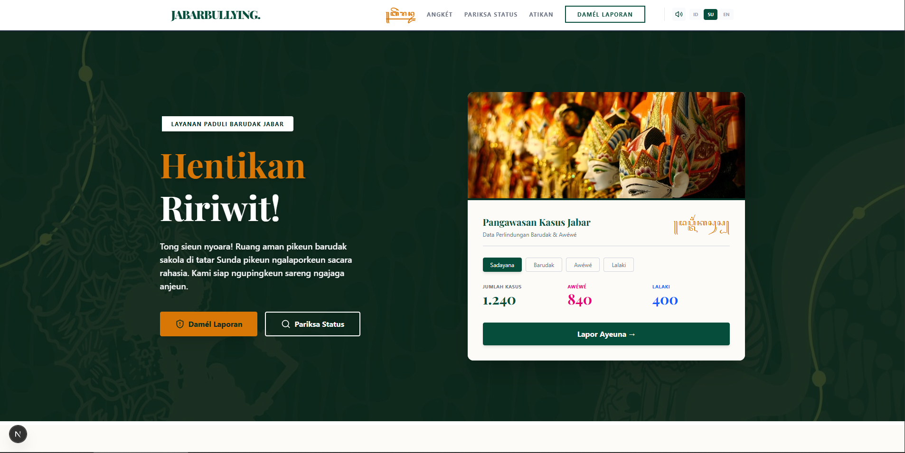

# JABARBULLYING
## 🛡️ Hentikan Ririwit!

<div align="center">
  
</div>

**JABARBULLYING** merupakan platform digital yang dirancang sebagai ruang aman bagi anak-anak untuk melaporkan tindakan perundungan (*bullying*), khususnya di lingkungan sekolah.

Platform ini mengusung pendekatan budaya Sunda melalui penggunaan bahasa dan identitas visual lokal. Tujuannya adalah meningkatkan kesadaran masyarakat mengenai pentingnya perlindungan anak serta mendorong terciptanya lingkungan sekolah yang aman, nyaman, dan bebas dari perundungan.

## ✨ Fitur Utama

- **Pelaporan Kasus**  
  Menyediakan fasilitas pelaporan tindakan perundungan melalui alur interaktif yang terdiri dari tujuh langkah.

- **Pemeriksaan Status Laporan**  
  Memungkinkan pengguna memantau perkembangan laporan menggunakan nomor tiket yang telah diberikan.

- **Pemantauan Kasus**  
  Menampilkan statistik dan informasi mengenai perkembangan kasus perundungan secara *real-time*.

- **Kategori Kasus**  
  Menyediakan pengelompokan data berdasarkan kategori, seperti anak, perempuan, dan laki-laki.

- **Multibahasa (5 Bahasa)**  
  Mendukung lima pilihan bahasa, yaitu Indonesia, Sunda, Inggris, Jepang, dan Spanyol. Platform ini juga dilengkapi fitur *Text-to-Speech* (TTS) yang menyesuaikan pengucapan dengan bahasa yang dipilih.

- **Tema Visual Dinamis**  
  Tampilan website, termasuk warna, jenis huruf, ornamen latar belakang, dan ilustrasi, akan menyesuaikan bahasa yang dipilih pengguna. Contohnya, tema Sakura untuk bahasa Jepang dan tema Flamenco untuk bahasa Spanyol.

- **Identitas Budaya Sunda**  
  Menggunakan elemen visual, ornamen, dan aksara Sunda sebagai identitas utama platform.

- **Aksesibilitas**  
  Dilengkapi fitur pembaca teks otomatis (*Text-to-Speech*) pada formulir pelaporan dan halaman edukasi hukum untuk membantu pengguna memahami informasi yang tersedia.

## 🛠️ Teknologi yang Digunakan

| Teknologi | Kegunaan |
|---|---|
| Next.js | Framework pengembangan frontend |
| React.js | Pembuatan antarmuka pengguna |
| Tailwind CSS | Pengaturan tampilan dan styling |
| Framer Motion | Animasi dan transisi antarmuka |
| Laravel | Framework pengembangan backend |
| PHP | Bahasa pemrograman backend |
| MySQL | Pengelolaan basis data |
| JavaScript | Pengembangan interaksi dan fungsionalitas |

## 📁 Struktur Repository

```text
website-antibullying/
│
├── frontend/              # Aplikasi Next.js
│   ├── app/
│   ├── components/
│   ├── public/
│   │   ├── jepang/        # Aset visual tema Jepang
│   │   ├── spanyol/       # Aset visual tema Spanyol
│   │   └── ...            # Aset visual tema lainnya
│   └── package.json
│
├── backend/               # Aplikasi Laravel
│   ├── app/
│   ├── routes/
│   ├── database/
│   ├── config/
│   └── composer.json
│
├── README.md
└── .gitignore
```

## ⚙️ Instalasi dan Konfigurasi

### 1. Clone Repository

Jalankan perintah berikut untuk mengunduh repository:

```bash
git clone https://github.com/USERNAME/website-antibullying.git

cd website-antibullying
```

### 2. Menjalankan Backend (Laravel)

Masuk ke direktori backend:

```bash
cd backend
```

Install seluruh dependensi yang dibutuhkan:

```bash
composer install
```

Salin file konfigurasi lingkungan:

```bash
copy .env.example .env
```

Buat application key:

```bash
php artisan key:generate
```

Selanjutnya, sesuaikan konfigurasi koneksi database melalui file `.env`, kemudian jalankan migrasi database:

```bash
php artisan migrate
```

Jalankan server backend Laravel:

```bash
php artisan serve
```

### 3. Menjalankan Frontend (Next.js)

Buka terminal baru dan masuk ke direktori frontend:

```bash
cd frontend
```

Install seluruh dependensi yang dibutuhkan, termasuk library untuk animasi dan antarmuka:

```bash
npm install
```

Buat atau sesuaikan file `.env.local` untuk mengatur alamat API backend:

```env
NEXT_PUBLIC_API_URL=http://127.0.0.1:8000/api
```

Jalankan development server:

```bash
npm run dev
```

Setelah server berjalan, buka website melalui browser:

```text
http://localhost:3000
```

## 🌐 Pengaturan Bahasa dan Tema

Pengguna dapat mengganti bahasa melalui tombol pilihan bahasa yang tersedia pada bagian **Navbar**.

Pilihan bahasa yang tersedia:

- **ID**: Bahasa Indonesia
- **SU**: Bahasa Sunda
- **EN**: Bahasa Inggris
- **JA**: Bahasa Jepang
- **ES**: Bahasa Spanyol

Pengaturan bahasa disimpan menggunakan `localStorage` pada browser.

Ketika pengguna mengganti bahasa, sistem akan menyesuaikan beberapa elemen secara otomatis, meliputi:

- Teks dan konten website.
- Pengucapan pada fitur *Text-to-Speech* (TTS).
- Warna dan tema visual.
- Jenis huruf dan ornamen latar belakang.
- Ilustrasi yang digunakan sesuai dengan tema bahasa yang dipilih.

## 🔐 Keamanan

Beberapa hal yang perlu diperhatikan dalam pengelolaan keamanan aplikasi:

- File `.env` dan `.env.local` tidak disertakan dalam repository.
- Kredensial database disimpan secara lokal dan tidak boleh dibagikan secara publik.
- Konfigurasi API harus disesuaikan dengan lingkungan pengembangan maupun produksi.
- Informasi laporan perundungan perlu dikelola dengan memperhatikan privasi dan keamanan data pengguna.

## 🎯 Tujuan Project

JABARBULLYING dikembangkan dengan beberapa tujuan utama:

1. Meningkatkan kesadaran masyarakat mengenai dampak dan bahaya perundungan.
2. Menyediakan sarana pelaporan perundungan yang mudah diakses.
3. Mendukung upaya perlindungan anak, khususnya di lingkungan sekolah.
4. Mendorong terciptanya lingkungan pendidikan yang aman, nyaman, dan bebas dari perundungan.
5. Memperkenalkan identitas budaya Sunda melalui pemanfaatan teknologi digital.

## 👨‍💻 Pengembangan

Project ini dikembangkan menggunakan arsitektur *frontend* dan *backend* yang terpisah dalam satu repository (*monorepo*).

- **Frontend**: Next.js, React.js, Tailwind CSS, dan Framer Motion.
- **Backend**: Laravel dan PHP.
- **Database**: MySQL.
- **Komunikasi**: REST API.

---

<div align="center">

**JABARBULLYING**

*Hentikan Ririwit, Jaga Barudak.*

</div>
